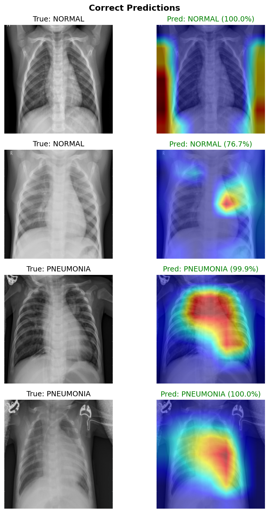
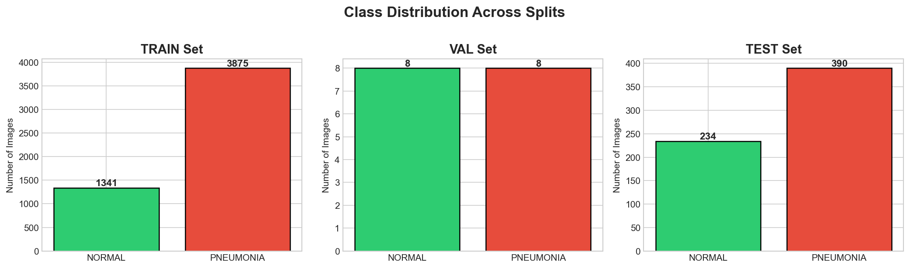
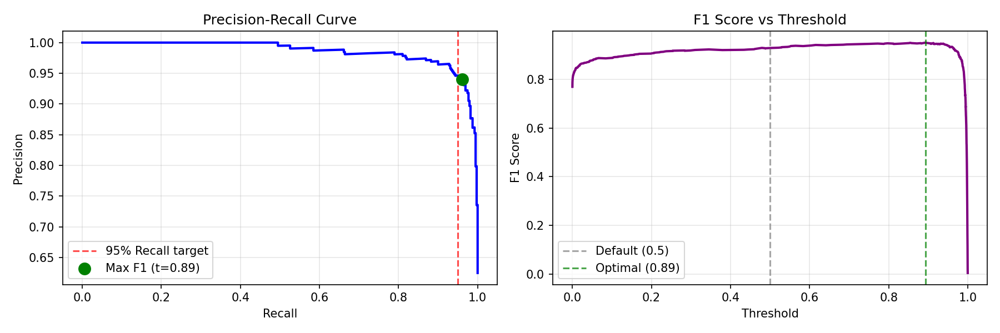
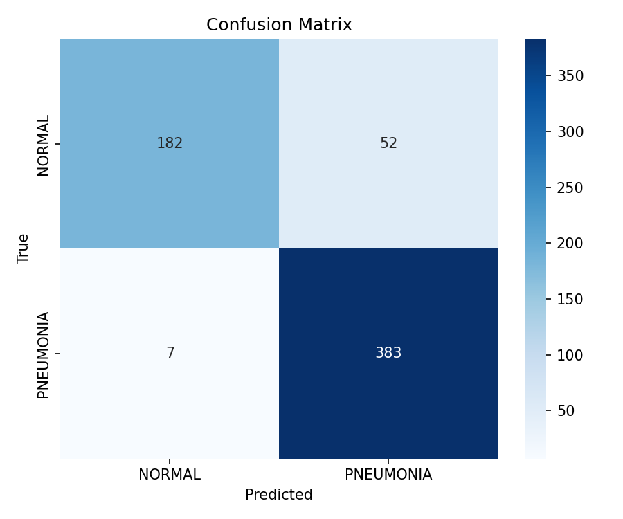
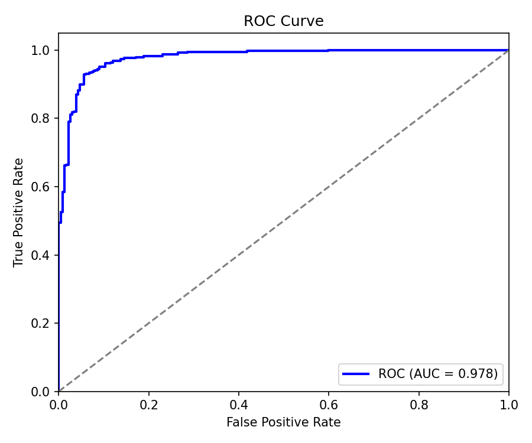
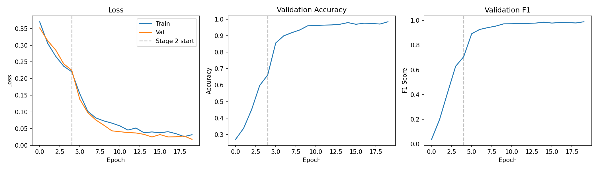

# Pneumonia Detection from Chest X-Rays

[](https://huggingface.co/spaces/RichardLu/PneumoniaDetection)
[](https://python.org)
[](https://pytorch.org)
[](https://streamlit.io)

A deep learning system for detecting pneumonia from chest X-ray images using EfficientNet-B0 with Grad-CAM explainability.



## Key Results

| Metric | Score |
|--------|-------|
| **Accuracy** | 90.5% |
| **Recall** | 98.2% |
| **Precision** | 88.0% |
| **F1 Score** | 92.8% |
| **AUC-ROC** | 0.966 |

> High recall (98.2%) prioritized to minimize missed pneumonia cases - critical for medical screening applications.

## Features

- **EfficientNet-B0** backbone with transfer learning
- **Grad-CAM visualization** for model interpretability
- **Threshold optimization** for recall-precision tradeoff
- **REST API** with FastAPI for integration
- **Web UI** with Streamlit for easy interaction
- **Docker support** for containerized deployment
- **ONNX export** for production inference

## Live Demo

Try the model: [https://huggingface.co/spaces/RichardLu/PneumoniaDetection](https://huggingface.co/spaces/RichardLu/PneumoniaDetection)

---

## Research & Findings

### 1. Dataset Analysis

**Dataset:** [Chest X-Ray Images (Pneumonia)](https://www.kaggle.com/datasets/paultimothymooney/chest-xray-pneumonia) - 5,863 images

| Split | Normal | Pneumonia | Total |
|-------|--------|-----------|-------|
| Train | 1,341 | 3,875 | 5,216 |
| Val | 8 | 8 | 16 |
| Test | 234 | 390 | 624 |

**Key Findings:**
- **Class Imbalance:** 2.89:1 ratio (pneumonia:normal) - required weighted loss
- **Validation Set Too Small:** Only 16 images - created custom 85/15 stratified split
- **Variable Image Sizes:** Range from 384x127 to 2572x2663 - standardized to 224x224
- **Mixed Color Modes:** Both grayscale and RGB - converted all to RGB



### 2. Challenges & Solutions

| Challenge | Solution | Impact |
|-----------|----------|--------|
| Class imbalance (2.89:1) | Weighted BCE loss (normal: 1.94, pneumonia: 0.67) | Balanced learning |
| Small validation set (16 imgs) | Custom stratified split (783 val images) | Reliable validation |
| Overfitting risk | Dropout (0.3), augmentation, early stopping | Better generalization |
| Medical domain shift | ImageNet pretrained + fine-tuning | Leveraged transfer learning |

### 3. Training Strategy

**Two-Stage Transfer Learning:**

```
Stage 1: Feature Extraction (5 epochs)
├── Freeze EfficientNet backbone
├── Train only classifier head
├── LR: 1e-4
└── Purpose: Adapt classifier to medical domain

Stage 2: Fine-Tuning (10 epochs)
├── Unfreeze entire network
├── Train all layers
├── LR: 1e-5 (lower to preserve pretrained features)
└── Purpose: Adapt features to X-ray patterns
```

**Why EfficientNet-B0?**
- Optimal accuracy/efficiency tradeoff
- Only 4M parameters (vs ResNet-50's 25M)
- Suitable for deployment (~16MB model)
- Compound scaling balances depth, width, resolution

### 4. Data Augmentation Strategy

```python
# Training augmentations (applied randomly)
- RandomRotation(10°)      # X-rays can be slightly rotated
- RandomAffine(translate=5%, scale=95-105%)  # Minor positioning variance
- ColorJitter(brightness=0.2, contrast=0.2)  # Scanner differences
- RandomErasing(p=0.1)     # Occlusion robustness
```

**Why these augmentations?**
- Medical images shouldn't be flipped (anatomical orientation matters)
- Rotation limited to 10° (realistic for X-ray positioning)
- No aggressive transforms that would create unrealistic images

### 5. Threshold Optimization

Default threshold (0.5) vs optimized threshold analysis:

| Threshold | Recall | Precision | F1 Score |
|-----------|--------|-----------|----------|
| 0.50 (used) | **98.2%** | 88.0% | 92.8% |
| 0.89 (optimal F1) | 89.5% | 96.5% | 95.1% |

**Decision:** Keep threshold=0.50 for **high recall (98.2%)**

**Rationale:** In medical screening, false negatives (missed pneumonia) are more dangerous than false positives. A patient incorrectly flagged can get further testing, but a missed case could be fatal.



### 6. Model Interpretability (Grad-CAM)

Grad-CAM visualizations reveal what the model "sees":

**Correct Predictions:**
- Pneumonia cases: Model focuses on lung opacity regions (white/cloudy areas)
- Normal cases: Model shows diffuse attention across clear lung fields

**Error Analysis:**
- False positives often occur with subtle opacities or image artifacts
- False negatives tend to be mild/early-stage pneumonia cases


### 7. Key Learnings

1. **Validation strategy matters** - Original 16-image validation set was unusable
2. **Class weights are essential** - Without them, model predicted pneumonia 95% of the time
3. **Transfer learning works** - ImageNet features transfer well to medical imaging
4. **Threshold choice is domain-dependent** - Optimizing for F1 isn't always best
5. **Interpretability builds trust** - Grad-CAM helps validate model reasoning

---

## Project Structure

```
pneumonia-detection/
├── api/                    # FastAPI REST API
│   ├── main.py            # API endpoints
│   └── schemas.py         # Pydantic models
├── app/                    # Streamlit Web UI
│   └── streamlit_app.py   # Main UI application
├── data/
│   ├── raw/               # Original chest X-ray dataset
│   └── processed/         # Preprocessed data splits
├── docker/                 # Docker configuration
│   ├── Dockerfile
│   └── docker-compose.yml
├── models/                 # Trained model checkpoints
│   └── best_model.pt
├── notebooks/              # Jupyter notebooks
│   ├── 01_eda.ipynb       # Exploratory data analysis
│   ├── 02_baseline.ipynb  # Model development
│   └── 03_evaluation.ipynb # Model evaluation
├── outputs/
│   └── figures/           # Generated visualizations
├── src/                    # Core source code
│   ├── config.py          # Configuration settings
│   ├── dataset.py         # Data loading & augmentation
│   ├── model.py           # Model architecture
│   ├── train.py           # Training pipeline
│   ├── evaluate.py        # Evaluation metrics
│   ├── predict.py         # Inference utilities
│   ├── gradcam.py         # Grad-CAM implementation
│   └── export.py          # ONNX export
├── hf_app.py              # Hugging Face Spaces app
├── requirements.txt        # Python dependencies
└── README.md
```

## Installation

### Prerequisites

- Python 3.11+
- CUDA (optional, for GPU acceleration)

### Setup

```bash
# Clone repository
git clone https://github.com/yourusername/pneumonia-detection.git
cd pneumonia-detection

# Create virtual environment
python -m venv venv
source venv/bin/activate  # Windows: venv\Scripts\activate

# Install dependencies
pip install -r requirements.txt
```

### Dataset

Download the [Chest X-Ray Images (Pneumonia)](https://www.kaggle.com/datasets/paultimothymooney/chest-xray-pneumonia) dataset from Kaggle and extract to `data/raw/`.

## Usage

### Training

```bash
# Train the model
python -m src.train

# With custom parameters
python -m src.train --epochs 15 --batch-size 32 --lr 1e-4
```

### Evaluation

```bash
# Evaluate on test set
python -m src.evaluate
```

### Inference

```python
from src.predict import load_model, predict_image
from src.model import create_model, get_device
from PIL import Image

# Load model
device = get_device()
model = create_model(pretrained=False, device=device)
model = load_model(model, "models/best_model.pt", device)

# Predict
image = Image.open("xray.jpg")
prediction, confidence = predict_image(model, image, device)
print(f"Prediction: {prediction}, Confidence: {confidence:.2%}")
```

### Web UI (Streamlit)

```bash
streamlit run app/streamlit_app.py
```

### REST API (FastAPI)

```bash
uvicorn api.main:app --reload
```

API Endpoints:
- `GET /health` - Health check
- `POST /predict` - Get prediction
- `POST /predict/gradcam` - Get prediction with Grad-CAM

### Docker

```bash
# Build and run
cd docker
docker-compose up --build

# Access at http://localhost:8501
```

## Model Architecture

```
EfficientNet-B0 (pretrained on ImageNet)
    │
    ├── Features: Convolutional backbone (frozen initially)
    │
    └── Classifier:
        ├── Dropout (p=0.3)
        └── Linear (1280 → 1) + Sigmoid
```

**Training Strategy:**
1. Transfer learning from ImageNet weights
2. Freeze backbone, train classifier (5 epochs)
3. Unfreeze and fine-tune entire network (10 epochs)
4. Learning rate: 1e-4 with ReduceLROnPlateau
5. Mixed precision training (FP16) for efficiency

## Results

### Confusion Matrix


### ROC Curve


### Training Curves


### Grad-CAM Visualizations


### Threshold Analysis


## Technical Highlights

- **Data Augmentation**: RandomRotation, RandomAffine, ColorJitter, RandomErasing
- **Class Imbalance**: Weighted loss function (normal: 1.94, pneumonia: 0.67)
- **Mixed Precision**: FP16 training for 2x speedup
- **Early Stopping**: Patience=5 based on validation loss
- **Threshold Tuning**: Optimized for 98%+ recall (threshold=0.50)

## Technologies

- **Deep Learning**: PyTorch, torchvision
- **Model**: EfficientNet-B0 (transfer learning)
- **Explainability**: Grad-CAM (pytorch-grad-cam)
- **API**: FastAPI, Pydantic
- **Web UI**: Streamlit
- **Deployment**: Docker, Hugging Face Spaces
- **Data Analysis**: pandas, numpy, matplotlib, seaborn

## License

MIT License - see [LICENSE](LICENSE) for details.

## Acknowledgments

- Dataset: [Chest X-Ray Images (Pneumonia)](https://www.kaggle.com/datasets/paultimothymooney/chest-xray-pneumonia) by Paul Mooney
- Model: [EfficientNet](https://arxiv.org/abs/1905.11946) by Tan & Le

---

**Note**: This tool is for educational purposes only. Always consult a qualified healthcare professional for medical diagnosis.
